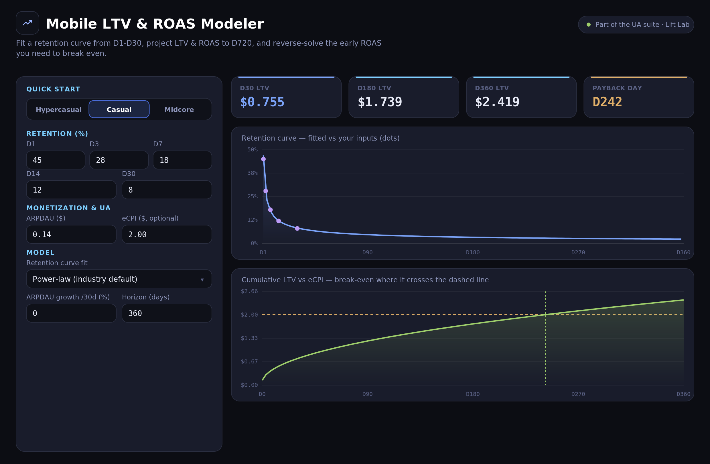
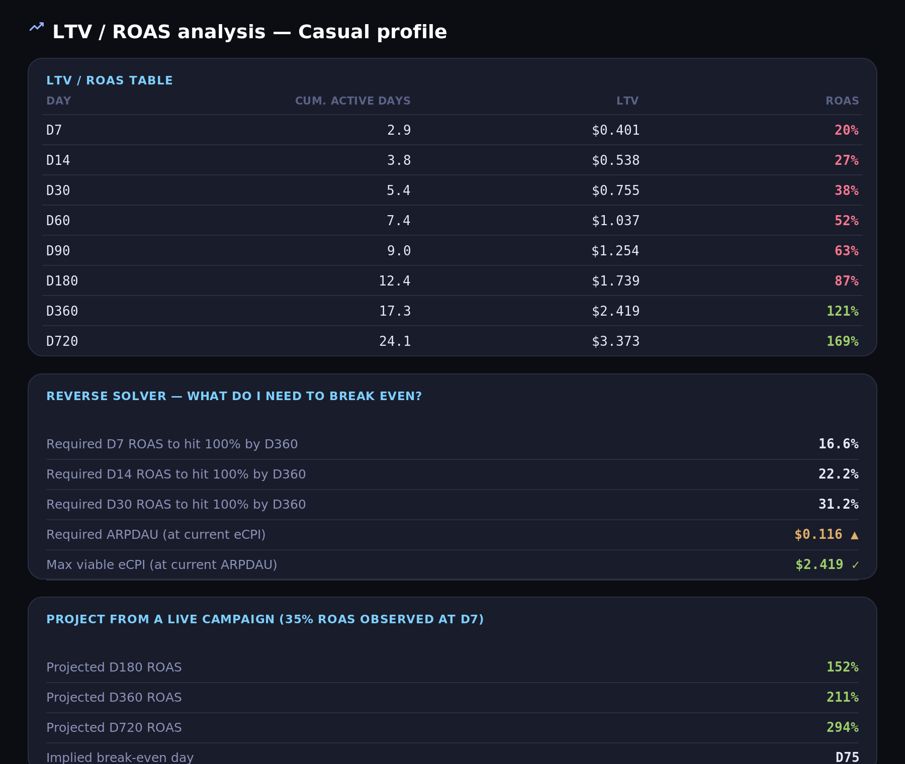

# 📈 Mobile LTV & ROAS Modeler

[](https://stonedhawk.github.io/mobile-ltv-roas-modeler/)

[](LICENSE)
[](#)
[](#)

**A single-file LTV & ROAS modeler for mobile game UA.** Enter your D1 to D30 retention. It fits a curve, projects LTV and ROAS out to D720, finds the day you pay back, and works backwards to the D7, D14 and D30 ROAS you need to break even. All calculation runs in the page. There is no backend, and nothing you enter is sent anywhere. The only network request is the Google Fonts stylesheet.

### ▶ Try it live: **[stonedhawk.github.io/mobile-ltv-roas-modeler](https://stonedhawk.github.io/mobile-ltv-roas-modeler/)**



> **Companion tool.** This models LTV and ROAS. [**Lift Lab**](https://stonedhawk.github.io/mobile-ua-incrementality-lab/) sizes and reads holdout tests and blends conflicting ROAS figures into one trust-weighted number.

---

## 🎯 What it answers

- **What's my D30 / D180 / D360 / D720 LTV** at this retention and ARPDAU?
- **When does this cohort pay back** at a given eCPI?
- **What D7 / D14 / D30 ROAS do I need** to hit a target ROAS (100% by default) by D180, D360, or D720? That's the reverse solver.
- **Where is a live campaign heading?** Enter an observed ROAS at day X and it projects D180, D360 and D720 ROAS and the implied break-even day.
- **What's the most I can pay per install**, or the ARPDAU I'd need, to make the target work?



---

## 🚦 Quick-start profiles

One click loads an illustrative starting profile so you're not staring at a blank form. These are example inputs, not benchmarks. The payback column is what the tool computes for each profile.

| Profile | Retention shape | ARPDAU | ARPDAU growth /30d | eCPI | Payback |
|---------|-----------------|--------|--------------------|------|---------|
| **Hypercasual** | D1 38% to D30 2.5% | $0.06 | 0% | $0.30 | D177 |
| **Casual** | D1 45% to D30 8% | $0.14 | 0% | $2.00 | D242 |
| **Midcore** | D1 50% to D30 14% | $0.40 | 5% | $7.50 | D122 |

All three use the power-law fit and no long-horizon anchor.

---

## 🧮 How the model works

| Step | Formula |
|------|---------|
| **Retention fit** | Ordinary least squares in log space on D1/D3/D7/D14/D30, plus an optional long-horizon anchor. Power-law `R(d)=A·d^b` (log-log), exponential `R(d)=A·e^(b·d)` (semi-log), or a blend (average of the two curves). Fitted values are clamped to 0 to 1. Day 0 = 1.0. |
| **Active days** | `ActiveDays(N) = 1 + Σ R(d)` for d = 1…N |
| **LTV** | `LTV(N) = Σ ARPDAU(d)·R(d)` for d = 0…N, with `ARPDAU(d) = ARPDAU₀·(1+g)^(d/30)` |
| **ROAS** | `ROAS(N) = LTV(N) / eCPI × 100%`; payback is the first day LTV ≥ eCPI |
| **Reverse solver** | Required ROAS at day E for target T% by day H: `T × LTV(E)/LTV(H)`. Required ARPDAU: `ARPDAU₀ × (eCPI·T/100) / LTV(H)`. Max eCPI: `LTV(H)·100/T` |
| **Campaign projection** | `ROAS(Y) = ROAS_obs × LTV(Y)/LTV(X)`; break-even is the first day this reaches 100% |

---

## ✅ Checking the math

[`checks/expected_values.py`](checks/expected_values.py) recomputes the worked examples below with numpy, from the formulas above rather than from `index.html`. The "Tool shows" column is what the live page displayed for the same inputs.

| Example | Expected (script) | Tool shows |
|---------|-------------------|------------|
| Casual preset, target 100% by D360, observed 35% at D7 | LTV D30 $0.7547, D180 $1.7385, D360 $2.4189; payback D242; required D7/D14/D30 ROAS 16.58% / 22.23% / 31.20%; max eCPI $2.4189; projected D180/D360/D720 152% / 211% / 294%, break-even D75 | $0.755, $1.739, $2.419; D242; 16.6% / 22.2% / 31.2%; $2.419; 152% / 211% / 294%; D75 |
| Midcore preset, horizon and target D720 | LTV D30 $3.0601, D720 $34.886; payback D122; required D7 ROAS 3.88%; required ARPDAU $0.0860 | $3.060, $34.89; D122; 3.9%; $0.086 |
| Blend fit, retention 42/25/16/10/6%, ARPDAU $0.20 growing 3%/30d, eCPI $3, anchor D90 at 3%, target 120% by D180, observed 20% at D14 | LTV D30 $1.0350, D180 $1.9941, D720 $3.0807; payback D677; required D7 ROAS 30.66%; max eCPI $1.6618; projected D720 87%, no break-even by D720 | $1.035, $1.994, $3.081; D677; 30.7%; $1.662; 87%; >D720 |

The LTV / ROAS table (active days, LTV and ROAS at D7 to D720) matched the script at every row for all three examples, and for the hypercasual preset (payback D177) and an exponential-fit case. No mismatches.

---

## ⚠️ Caveat

With no long-horizon anchor, the curve is fit on 30 days of data or less, so D360 and D720 are extrapolation. Two common reasons far-horizon numbers drift from reality:

1. **Long-tail retention can decay more slowly than the fitted curve.** The fit has no information past your last data point.
2. **ARPDAU can rise** as low-value users churn and payers make up more of the cohort.

Drop a real D60, D90 or D180 retention point into the *Long-horizon anchor* field to pin the tail, use the **ARPDAU growth** input, and read far-horizon numbers as a band, not a single point. The tool shows a warning whenever the horizon goes past D30, or past your anchor day if you set one.

---

## 🚀 Run it

Use the **[hosted version](https://stonedhawk.github.io/mobile-ltv-roas-modeler/)**, or run it locally. It's one file with no build step:

```bash
git clone https://github.com/stonedhawk/mobile-ltv-roas-modeler.git
open mobile-ltv-roas-modeler/index.html
```

`open` is macOS; on other systems open `index.html` in any browser.

---

## 📄 License

[MIT](LICENSE). Use it inside your studio or fork it freely.

---

Built by [Rahul Shah](https://github.com/stonedhawk). 16 years producing mobile games by day, packaging producer problems into tools by night.
